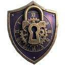

<table>
  <tr>
    <td width="128">
      
    </td>
    <td>
      <h1>NueM8 ChronoLock</h1>
      <p>Precision credential dispatch. Forged in local memory, dissolved by time.</p>
      <p>
        <code>Single-Use AES-256</code>
        <code>100% Client-Side Encryption</code>
        <code>Zero Telemetry</code>
      </p>
    </td>
  </tr>
</table>

A small secret-sharing tool. The secret is encrypted in the browser. ChronoLock stores only the ciphertext. The link dies after one reveal, or when its time runs out.

This is a standalone program, served at [chronolock.nuem8.com](https://chronolock.nuem8.com/). It does not send a secret, a link, or a visit to NueM8.

## Where it comes from

ChronoLock comes from [The NueM8 Philosophy](https://nuem8.com/philosophy): precision, sovereignty, and craft. A secret stays in the browser until it is encrypted. The key stays in the link. What is stored stays on the machine that runs ChronoLock, in memory or in a local database. The program does one job, stays small, and leaves the secret when its time is up.

## What the server can see

The page generates a random key and encrypts the secret with AES-GCM before the upload. The key is placed after `#` in the link. Browsers do not send that part to the server, so ChronoLock cannot read the secret, and neither can a database copy.

Opening the link does not burn it. Link previews only receive the page. The secret is fetched when the recipient presses Reveal. If “Delete after one reveal” is on, that press deletes the ciphertext. Either way, the row is deleted when its lifetime ends.

Memory storage dies with the process. SQLite storage keeps unexpired secrets across a restart, still without the key.

## Run

```
cargo run --release -- --listen 127.0.0.1:8787 --store sqlite --data chronolock.db
```

Memory mode:

```
cargo run --release -- --listen 127.0.0.1:8787 --store memory
```

ChronoLock listens on localhost until you put it behind HTTPS. WebCrypto will not encrypt on a public `http://` page. A reverse proxy should forward to this address. Pass `--trust-proxy` only when the proxy connects from loopback, so the rate limit sees the visitor address. That address is kept in memory for the limit. It is not written to the database.

The longest lifetime is 7 days unless you set `--max-ttl` in seconds.

## Limits

One secret can be 32KB, counted in UTF-8 bytes. It is sized for passwords, API keys, and small configuration blocks (typical .env files). It is not a general pastebin or file-sharing service. The page shows the limit and refuses anything larger. The server refuses a ciphertext larger than that same secret plus the 28-byte AES-GCM header. There is no account, no log of the secret, and no log of the link id. This is a dead drop for a password or a key, not a password manager.

## Developer

ChronoLock is built by Kevin Roper at NueM8. To report a problem or ask a question, email [admin@nuem8.com](mailto:admin@nuem8.com) or use the [contact form](https://nuem8.com/contact).
